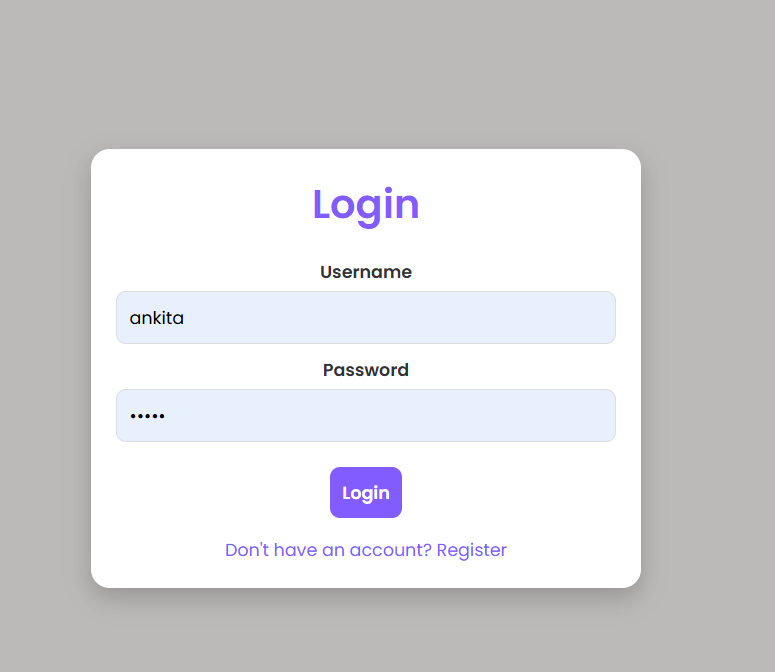
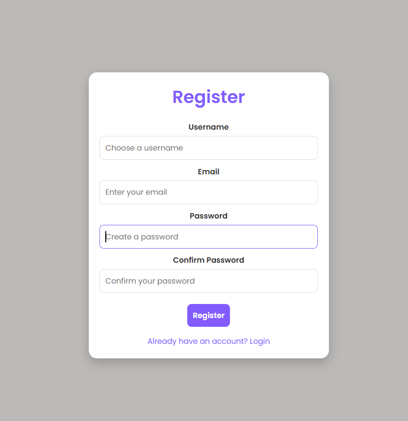
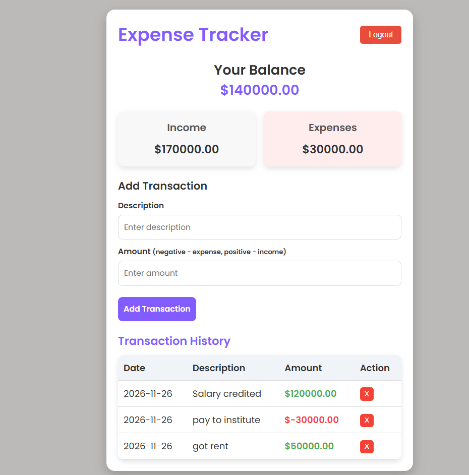

# 💰 Expense Tracker – Full Stack Web Application

A full-stack **Expense Tracker Application** built using **Java, Spring Boot, Spring Data JPA, MySQL-compatible TiDB Cloud, HTML, CSS, and JavaScript**.

The application allows users to register, log in, manage their income and expenses, track transaction history, and monitor their overall financial balance through an interactive dashboard.

🌐 **Live Application:** [Expense Tracker](https://expense-tracker-frontend-z21p.onrender.com/)

---

## 🚀 Live Demo

| Component | Deployment                                                                 |
| --------- | -------------------------------------------------------------------------- |
| Frontend  | [Render Static Site](https://expense-tracker-frontend-z21p.onrender.com/)  |
| Backend   | [Spring Boot REST API](https://expense-tracker-backend-romo.onrender.com/) |
| Database  | TiDB Cloud                                                                 |

---

## 📸 Application Screenshots

### 1. Login Page



### 2. Registration Page



### 3. Transaction Dashboard



---

## ✨ Features

### 👤 User Authentication

- User registration with required details.
- User login functionality.
- Backend API integration for authentication.

### 💸 Transaction Management

- Add income and expense transactions.
- View transaction history.
- Delete existing transactions.
- Track financial activities.

### 📊 Dashboard

- Display total balance.
- View total income.
- View total expenses.
- Dynamically update transaction information.

### ⚙️ Backend

- RESTful APIs using Spring Boot.
- Layered architecture with Controller, Service, and Repository layers.
- Database integration using Spring Data JPA and Hibernate.
- Automatic database table management through Hibernate.

### 🎨 Frontend

- Interactive user interface using HTML and CSS.
- JavaScript for API integration and dynamic updates.
- Separate login, registration, and transaction dashboard pages.

---

## 🛠️ Tech Stack

| Category             | Technologies               |
| -------------------- | -------------------------- |
| Programming Language | Java 21                    |
| Backend Framework    | Spring Boot 3.5.4          |
| ORM                  | Hibernate, Spring Data JPA |
| Frontend             | HTML5, CSS3, JavaScript    |
| Database             | MySQL / TiDB Cloud         |
| Build Tool           | Maven                      |
| Containerization     | Docker                     |
| Backend Deployment   | Render Web Service         |
| Frontend Deployment  | Render Static Site         |
| Cloud Database       | TiDB Cloud                 |

---

## 🏗️ Application Architecture

The application follows a frontend-backend architecture.

```text
             User
              |
              v
      Frontend (HTML/CSS/JS)
              |
          REST APIs
              |
              v
       Spring Boot Backend
              |
       Controller Layer
              |
         Service Layer
              |
       Repository Layer
              |
              v
       Hibernate / JPA
              |
              v
       TiDB Cloud Database
```

---

## 📂 Project Structure

```text
Expense-Tracker/
│
├── src/
│   └── main/
│       ├── java/
│       │   └── com/example/Expense/Tracker/
│       │       ├── Controller/
│       │       ├── Service/
│       │       ├── Repository/
│       │       ├── Entity/
│       │       └── ExpenseTrackerApplication.java
│       │
│       └── resources/
│           └── application.properties
│
├── Expense-Tracker-Frontend/
│   ├── index.html
│   ├── login.html
│   ├── register.html
│   ├── expense_tracker.html
│   ├── styles.css
│   └── script.js
│
├── Dockerfile
├── pom.xml
├── .gitignore
└── README.md
```

---

## ⚙️ Local Installation and Setup

### 1. Clone the Repository

```bash
git clone https://github.com/ankitakr9/expense-tracker.git
```

### 2. Open the Backend Project

Import the project into IntelliJ IDEA or Eclipse as a Maven project.

### 3. Configure MySQL

Create the database:

```sql
CREATE DATABASE expense_tracker;
```

Configure your database credentials in `application.properties`:

```properties
spring.datasource.url=jdbc:mysql://localhost:3306/expense_tracker
spring.datasource.username=YOUR_USERNAME
spring.datasource.password=YOUR_PASSWORD

spring.jpa.hibernate.ddl-auto=update
spring.jpa.show-sql=true
```

Replace the username and password with your local MySQL credentials.

### 4. Run the Backend

Run the main Spring Boot application:

```text
ExpenseTrackerApplication.java
```

The backend will start at:

```text
http://localhost:8080
```

### 5. Run the Frontend

1. Open the `Expense-Tracker-Frontend` folder in VS Code.
2. Open `login.html` using Live Server.
3. Make sure the frontend API URLs point to your local backend:

```javascript
http://localhost:8080
```

You can now register, log in, and manage transactions locally.

---

## ☁️ Deployment

The application is deployed using the following services:

### Frontend – Render

- Deployed as a Render Static Site.
- Connected directly to the GitHub repository.
- Uses `Expense-Tracker-Frontend` as the root directory.
- `index.html` redirects visitors to the login page.

### Backend – Render

- Deployed as a Docker-based Web Service.
- Docker builds the Spring Boot application using Java 21 and Maven.
- Backend APIs are accessible through the deployed service URL.

### Database – TiDB Cloud

- Uses TiDB Cloud Starter as the cloud database.
- MySQL-compatible database connection.
- Database credentials are configured through Render environment variables.
- Hibernate manages database table creation and updates.

**Note:** Database credentials and other sensitive configuration values are stored as environment variables and are not committed to GitHub.

---

## 🔐 Environment Variables

The deployed backend uses the following environment variables:

| Variable                        | Purpose                                           |
| ------------------------------- | ------------------------------------------------- |
| `PORT`                          | Port on which the Render web service runs         |
| `SPRING_DATASOURCE_URL`         | TiDB Cloud database JDBC URL                      |
| `SPRING_DATASOURCE_USERNAME`    | Database username                                 |
| `SPRING_DATASOURCE_PASSWORD`    | Database password                                 |
| `SPRING_JPA_HIBERNATE_DDL_AUTO` | Hibernate table creation and update configuration |

These variables are configured through the Render dashboard. Database credentials and other sensitive configuration values are not committed to GitHub.

**Note:** `PORT` is automatically provided by Render.

## 👩‍💻 Author

**Ankita Pandey**

- GitHub: [ankitakr9](https://github.com/ankitakr9)
- LinkedIn: [Ankita Kumari](https://www.linkedin.com/in/ankitakr9/)

---

## 🤝 Contributing

Contributions, suggestions, and improvements are welcome!

Feel free to fork this repository, open an issue, or submit a pull request.
